# Tutorial: one recipe for two PDFs of one layout

Two service agreements have the same fields and do not look alike: one is a single column with `DETAILS`,
`PRICE` and `TERMS` in capitals, the other has two columns, `Details`, `Price` and `Terms`, a different
header and footer, and a longer description. This tutorial builds **one** recipe in the Studio from the first
and shows it reading the second.

- **Video** (about 3 minutes, narrated): [pdf-agreements.mp4](../assets/studio/pdf-agreements/pdf-agreements.mp4)
- **The finished recipe**: [examples/pdf-agreements](../../examples/pdf-agreements)
- **The documents**: [agreement.pdf](../../examples/pdf-agreements/agreement.pdf) and
  [agreement-two-columns.pdf](../../examples/pdf-agreements/agreement-two-columns.pdf)

The pictures and the video are produced by [capture/pdf-agreements.mjs](./capture/pdf-agreements.mjs), which
drives the Studio the way these steps do; run it again after a change to the Studio and they follow.

## The idea

A PDF has no structure of its own: the engine only knows lines of text at positions. A recipe that says "the
text in this box" breaks as soon as a description is longer, because everything under it moves. So the recipe
is anchored on what the two documents **do** share: a label before a value, a heading above a block of text,
a header row above a table.

| Field | What it is in both documents | What the recipe anchors on |
|---|---|---|
| reference, effective date, status | `Label: value` | the label |
| details | the text between the `Details` and `Price` headings | the two headings |
| terms | everything under `Terms`, over a page break | the heading |
| price tiers | a table | its header row, until the next heading |

## 1. Open the Studio and load the first document

```sh
opencraw studio ./agreements
```

An empty folder. **Load ▾** brings in what the recipe reads.

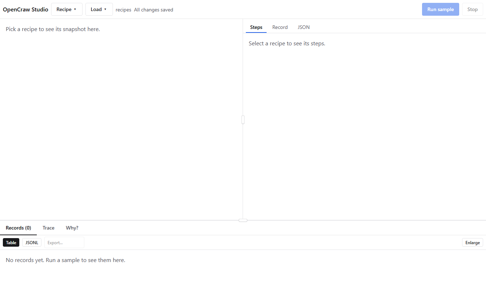

Choose **Document…** and pick `agreement.pdf`.

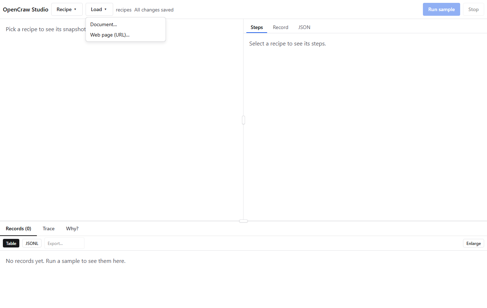

The Studio copies the file next to the recipes (the recipe refers to it by name, `file:agreement.pdf`, so the
folder can be moved) and starts a recipe named after it. The page is drawn with every line the engine found
outlined, the way the recipe will see it.

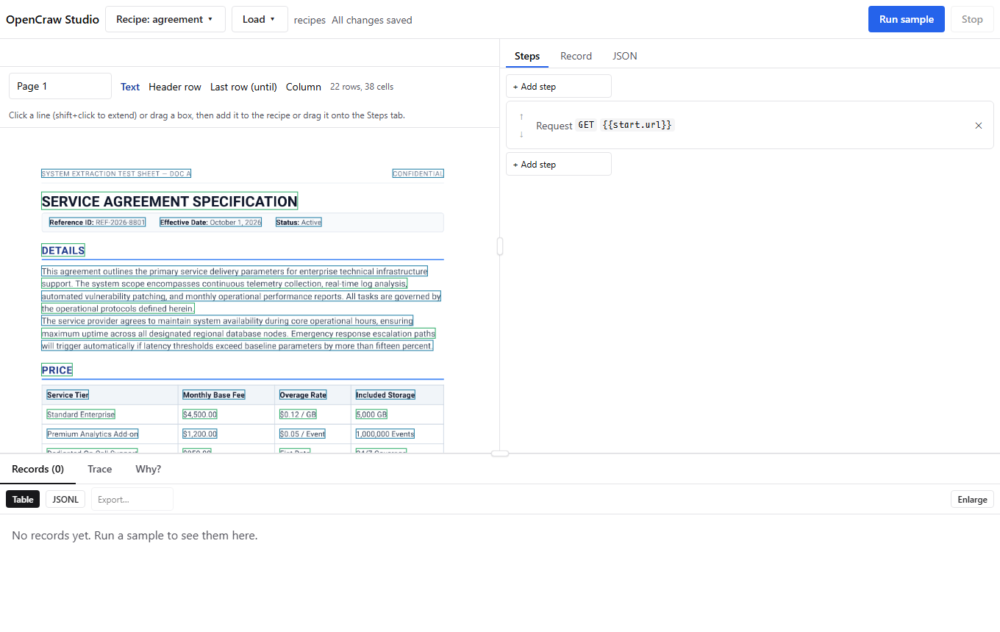

## 2. Pick the values that have a label

Click `Reference ID: REF-2026-8801`. The chip says what the step will be tied to: **Reads the value after its
label**. The step is a `regex` on `Reference ID:`, so it finds the value wherever the line is, and the value
does not carry its label.

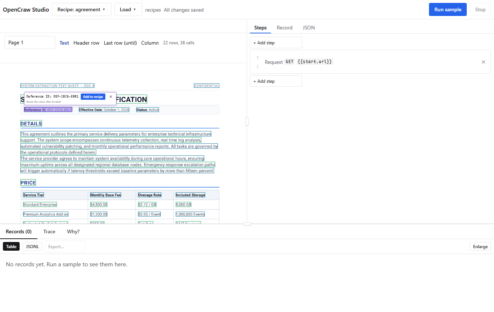

**Add to recipe**, then do the same for the effective date and the status. The three steps are named after
their labels: `referenceId`, `effectiveDate`, `status`.

## 3. Pick the description: the text between two headings

Click any line under **DETAILS**. The Studio sees a heading above it and another heading of the same size
below (`PRICE`), and ties the selection to them: **Reads what is between “DETAILS” and “PRICE”**. The whole
block is highlighted, not the line you clicked.

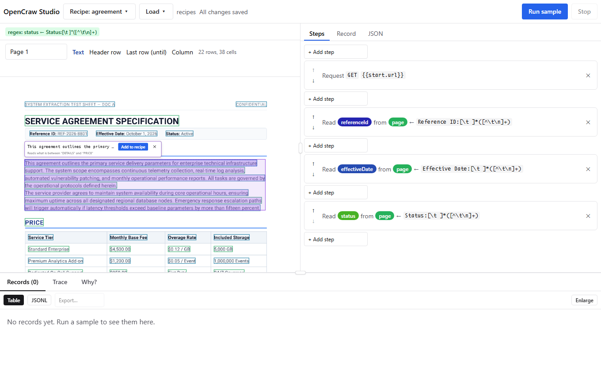

The step is a `section` with `selector: "^DETAILS$"` and `until: "^PRICE$"`. In another document it reads
whatever is between those two headings, however many paragraphs, however many columns.

## 4. Pick the terms: everything below a heading

Click a line under **TERMS**. Nothing follows it, so it reads **everything below “TERMS”**, over the page
break. The document repeats a header and a footer on each page; the Studio notices (the same text at the same
height on more than one page) and writes `ignoreHeadersFooters: true`, so the footer does not end up in the
middle of a sentence.

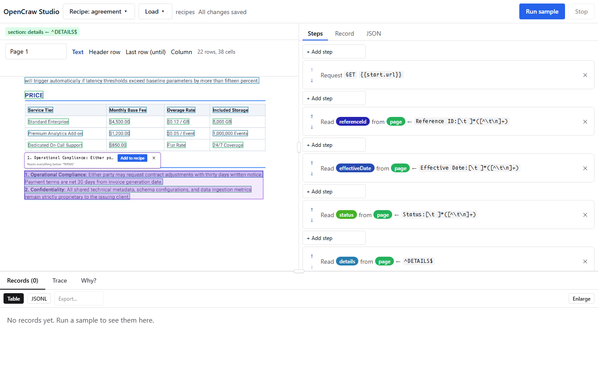

## 5. Pick the table

Choose the **Header row** mode and click the table's header (`Service Tier`), then the **Last row (until)**
mode and click the heading that follows the table (`TERMS`). The badge above the page says what was picked:
`table: ^Service Tier until ^TERMS`.

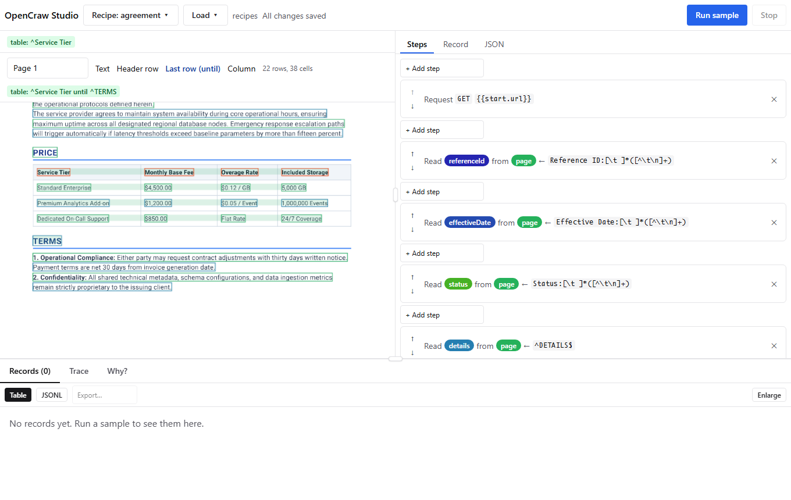

## 6. The input recipe

The **Steps** tab shows the recipe so far: a request for the document, three values by label, two sections
and a table. There is no coordinate in it.

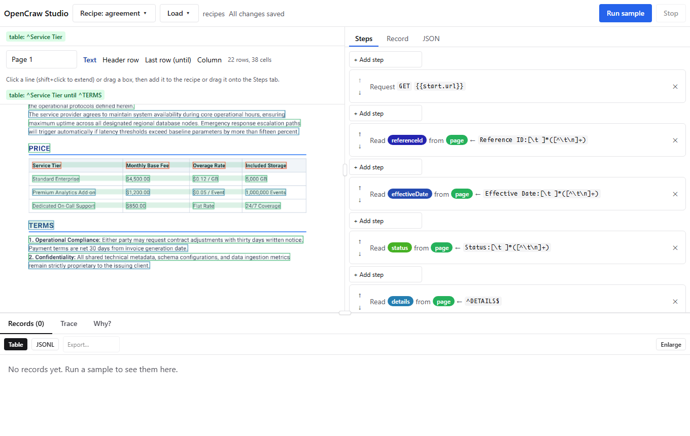

## 7. The output recipe

The **Record** tab is the output side: what a record of this recipe looks like. The Studio proposes one field
for each value the steps read, with a type guessed from what it is (a block of text is a `string` whatever
its name says; the table's rows are a `json` list).

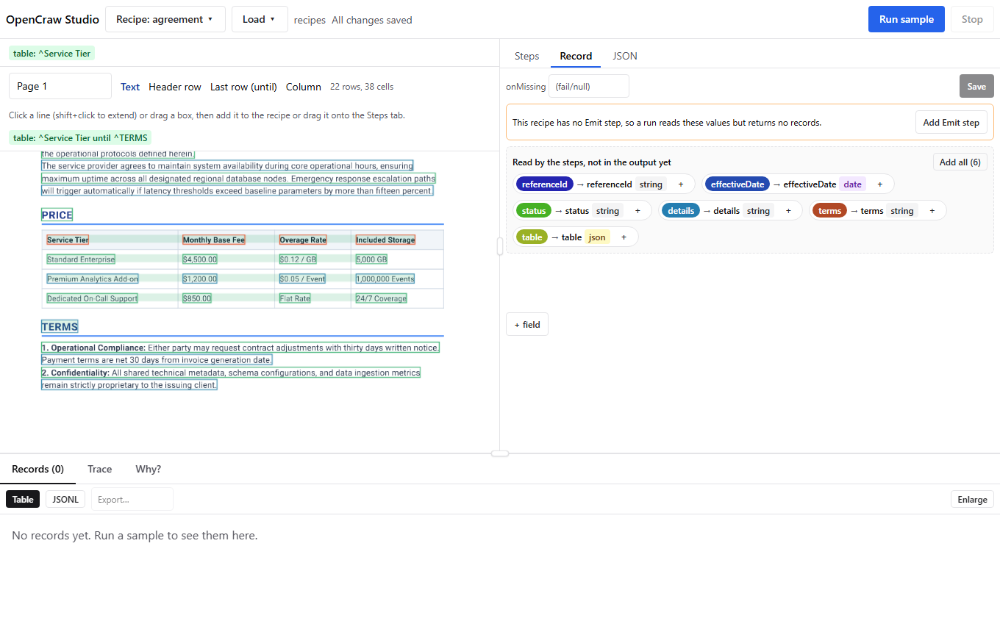

A recipe with fields but no **Emit** step reads values and returns nothing, so the tab says so and offers
**Add Emit step**. Then **Add all** adds every proposal as a field together with its mapping. Rename the
table's field (`table`) to `tiers` and **Save**: this writes both files, `agreement.ocw-in.json` (the input
recipe, with its `mapping`) and `agreement.ocw-out.json` (the output recipe, with its `fields`).

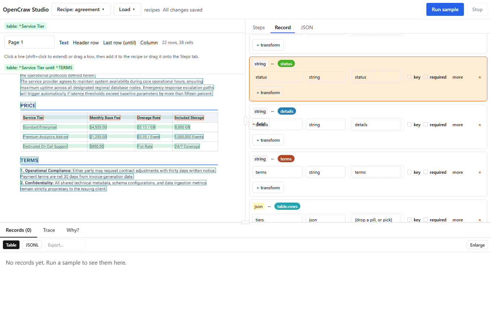

## 8. Run it on the first document

**Run sample** runs the recipe and shows the record: the reference, the effective date as a date, the status,
the description in one piece, the terms numbered, and the tiers.

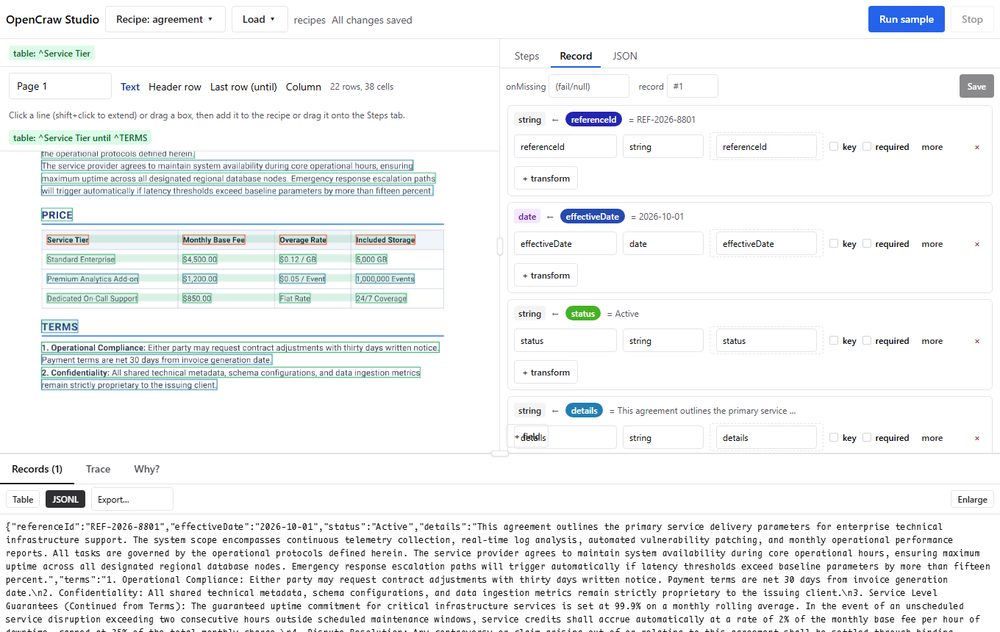

The **JSON** tab shows exactly what was written. Every step is anchored on a heading or a label.

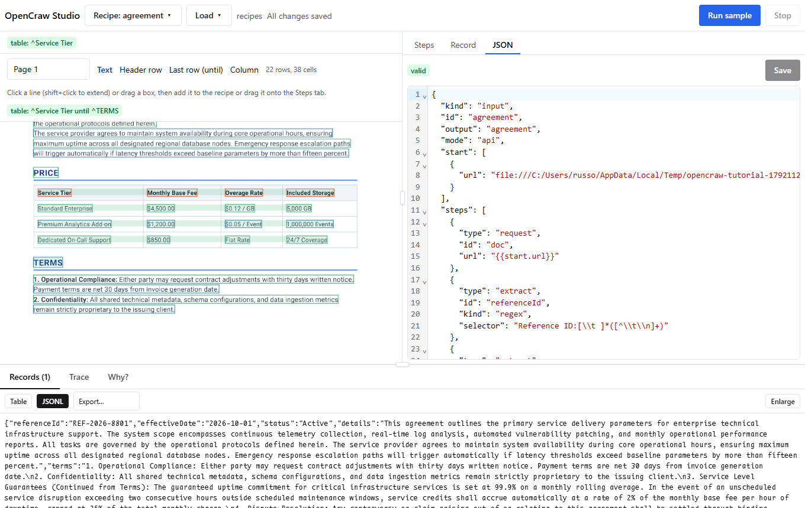

## 9. Load the second document

**Load ▾ › Document…** again, with `agreement-two-columns.pdf`. Loading a document into a recipe that reads a
document replaces its start address and keeps every step; the notice under the toolbar says what it replaced.
The page now looks different: two columns, `Details` in lower case, another header, another footer, a longer
description.

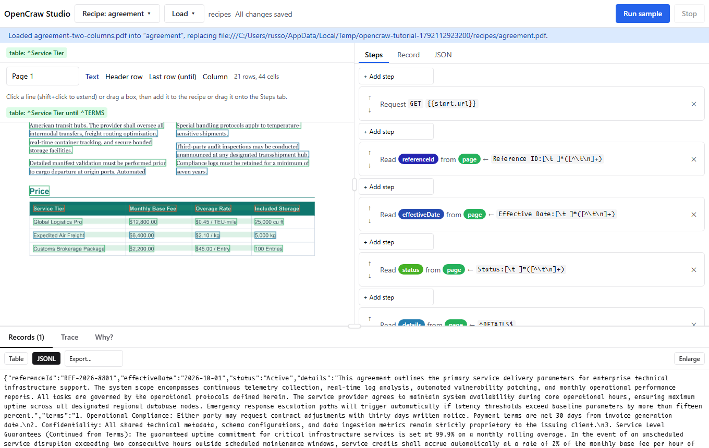

## 10. Run it again

**Run sample.** The same recipe reads the new document: the description comes out in reading order, left
column and then right; the terms run over the page break, numbered, with no footer inside; the table has its
three tiers and not the footer row that sits right under it.

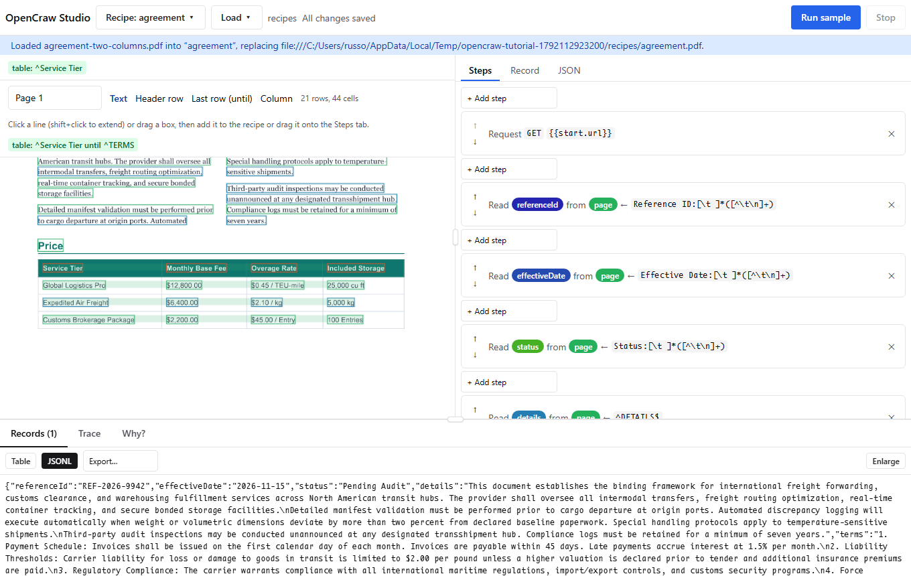

## What to do when a document does not fit

- **A value is missing.** Open **Why?** and click the missing cell: it names the step that found nothing. A
  `section` finds nothing when its heading is not in the document (a different wording): change its
  `selector`, or make it a pattern that accepts both (`^(Details|Description)$`).
- **A block ends too early or too late.** Give the `section` an `until` (the heading that follows it).
- **A footer is in the text.** Add `ignoreHeadersFooters: true` to the step.
- **A value has no label and no heading above it.** Then only a position is left: drag a box on the page.
  The chip says **Reads a fixed position on the page: it breaks when the layout moves**, which is the
  Studio telling you this step will not survive a document of another layout.

Reference: the [`section`, `table` and `regex` extracts of a PDF](../recipes/authoring.md#46-pdfs).
